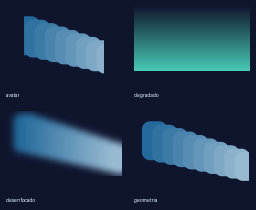
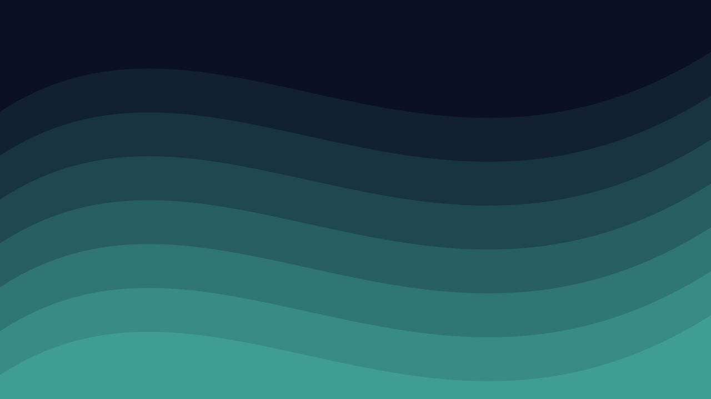
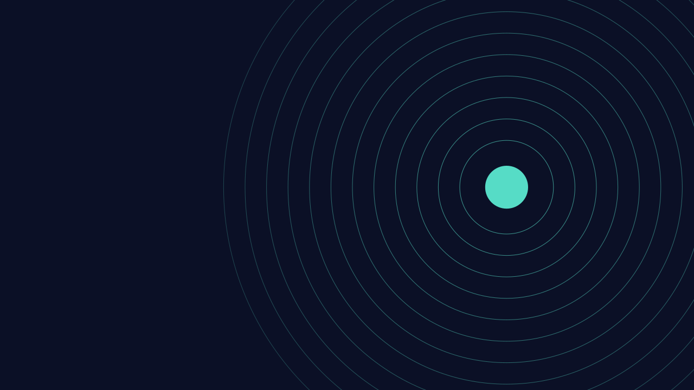
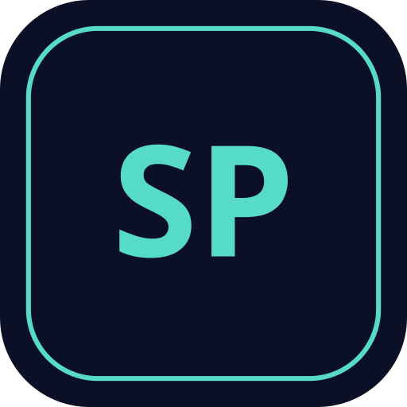
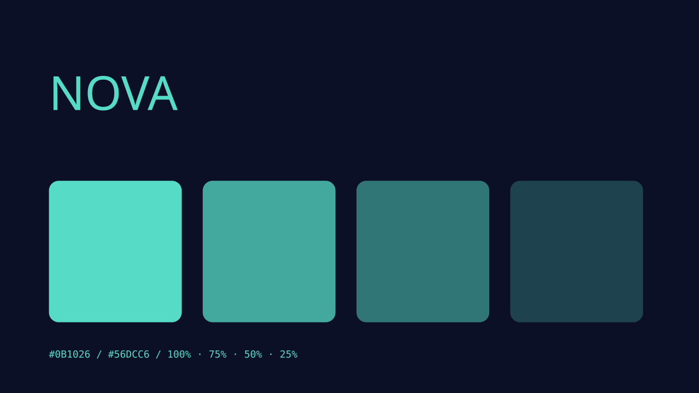
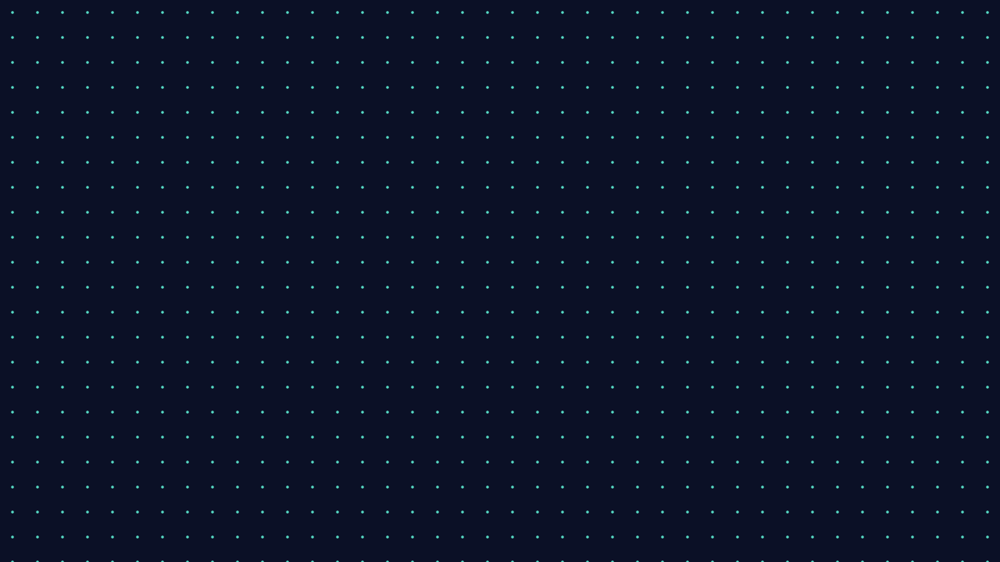
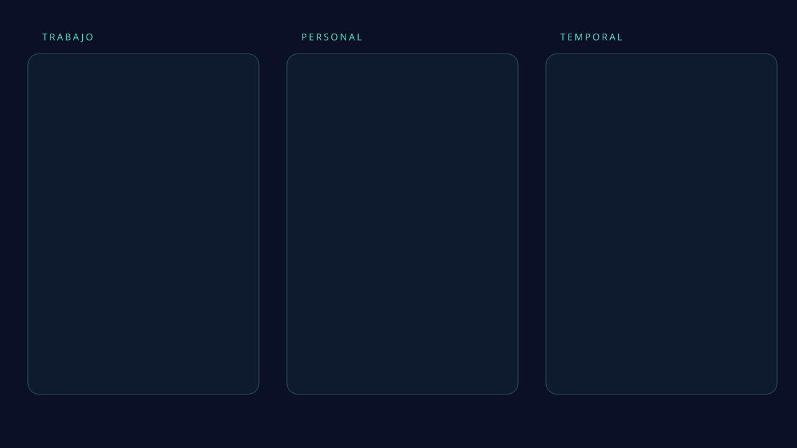

# Resultados reales de los generadores

Estos archivos se han creado ejecutando los scripts con datos sintéticos.
Los SVG son editables y los PNG se pueden usar como fondos estáticos.
No se han aplicado cambios al escritorio de ningún equipo.

## Vista de los PNG generados



- [Degradado PNG](diseno/degradado.png)
- [Foto geométrica de prueba](diseno/geometria.png)
- [Fondo desenfocado](diseno/desenfocado.png)
- [Avatar cuadrado](diseno/avatar.png)
- [Icono ICO de siete tamaños](diseno/icono.ico)
- [Paleta extraída en JSON](diseno/paleta.json)

## Fondos y recursos SVG

### fondo-degradado-svg


[Descargar SVG](diseno/fondo-degradado-svg.svg)

### fondo-mosaico-svg


[Descargar SVG](diseno/fondo-mosaico-svg.svg)

### fondo-ondas-svg



[Descargar SVG](diseno/fondo-ondas-svg.svg)

### fondo-orbitas-svg



[Descargar SVG](diseno/fondo-orbitas-svg.svg)

### icono-monograma-svg



[Descargar SVG](diseno/icono-monograma-svg.svg)

### panel-inspiracion-svg



[Descargar SVG](diseno/panel-inspiracion-svg.svg)

### rejilla-puntos-svg



[Descargar SVG](diseno/rejilla-puntos-svg.svg)

### zonas-escritorio-svg



[Descargar SVG](diseno/zonas-escritorio-svg.svg)

## Reproducir desde la raíz

Usa nombres nuevos o una carpeta distinta: los generadores no sobrescriben.

```powershell
py fondo-ondas-svg/script.py ondas.svg --primario "#0B1026" --secundario "#56DCC6"
py icono-monograma-svg/script.py iniciales.svg --ancho 512 --alto 512 --texto SP
py fondo-degradado-png/script.py escritorio.png --ancho 2560 --alto 1440
py fondo-desenfocado/script.py ejemplos/diseno/geometria.png suave.png
py imagen-a-ico/script.py ejemplos/diseno/avatar.png icono.ico
py contraste-colores/script.py "#FFFFFF" "#0B1026"
```
